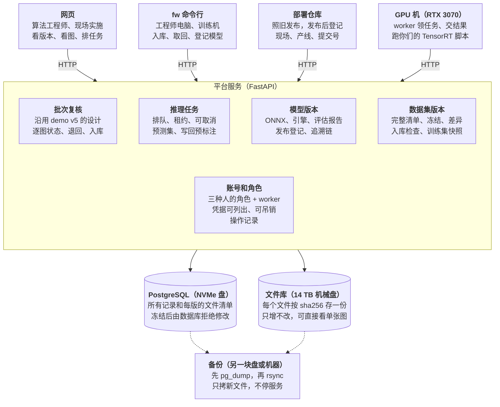

# 数据飞轮底座：开源方案复查与自研架构

> 这是[在线设计文档](https://claude.ai/artifact/A8f2NKVHhLEF295TwomviL) 2026-11-03 的副本，放在仓库里方便审代码时对照；设计改了会在对应的 PR 里同步更新这份。文中 claude.ai 的链接和“项目文件”只有项目成员能打开。

## 结论

没有合适的单个开源项目，推荐自己写：一个服务、一个 PostgreSQL、一个按内容哈希存文件的文件库，三项需求都放在里面。

- 逐项看（下一节）：数据集版本最成熟的 DVC 在 2025 年 11 月被 lakeFS 收购后基本只做维护；lakeFS 开源版只剩单个用户、没有权限；Oxen 还没到 1.0。模型版本的事实标准 MLflow 要连带装整个实验跟踪服务。预标注没有能直接用的，因为标注在 LiteAnno、推理用你们自己的 TensorRT 代码，开源项目只能提供排队。
- 拼两三个开源项目，就有两三套存储、账号和备份；现场、产线、批次、引擎、发布这些哪套都没有，还是要自己写，再加上它们之间的同步代码。
- 我的判断（不是证明）：三项需求里最要紧、也最容易出错的，是文件按内容存、版本不可改、取回来和存进去一模一样。ClearML 恰恰在这里出了错（2.1.x 里复制或改名过文件的版本取不回）。这部分放在第一步，用测试和故障演练钉住；第三步的任务租约和重试是第二个要特别小心的地方。
- 和 ClearML 方案相比：不再需要 MongoDB、Elasticsearch、Redis；备份不用停服务；网页能直接看单张图；权限由我们自己的服务管。代价是网页要自己做，这部分代码以后也归我们维护。
- 已定（2026-11-03）：放弃 ClearML，改为自研。第一步（文件库、数据集版本、命令行）已经做完，[PR #1](https://github.com/LorenzoSun-V/aoi-flywheel/pull/1) 等你审；之后在试点服务器上用同一批 SES TX 数据重跑入库、冷取回和复制改名的检查。

## 开源方案逐项复查

三项需求各看了一遍，每项都没有既合适又轻的现成项目。星数、issue 数和发布日期取自 GitHub 和 PyPI，截至 2026-11-03。

**数据集版本**

| 方案 | 现状 | 合适的地方 | 不合适的地方 |
| --- | --- | --- | --- |
| [DVC](https://github.com/treeverse/dvc) | 1.6 万星；2025-11-18 被 lakeFS 收购，承诺维护和修 bug；最新版 3.67.1 是 2026-03-31 发的，8 月以来主分支 2 次提交 | “按内容哈希存文件 + 每版一个清单”的设计最成熟；纯客户端，存储用本地盘或 SSH 都行 | 每个版本是一次 git 提交，平台服务里要托管 git 仓库；之前的试验里，硬链接缓存被就地改 JSON 改坏了旧版本的 100 个文件（默认的复制模式没问题） |
| [lakeFS](https://github.com/treeverse/lakeFS) | 5.6 千星，355 个未关闭 issue | 服务端像 git 一样管文件：提交、差异、回滚 | 开源版 2024 年起只剩单个用户、没有权限控制，RBAC 和单点登录在企业版；要 PostgreSQL 加 MinIO 或本地块存储，本地块存储不支持垃圾回收；分支合并我们用不上 |
| [Oxen](https://github.com/Oxen-AI/Oxen) | 1.2 千星；0.65.2，几天一个发布 | 专做大数据集版本，Rust 写的 | 还没到 1.0，接口还在变，用的人少，上生产风险大 |
| ClearML 数据集（试点） | 6.9 千星；SDK 488 个、服务端 124 个未关闭 issue | 版本、血缘、冻结都有，网页现成 | SDK 2.1.x 里复制或改名过文件的版本取不回，只能锁 2.0.2；文件打成 zip，网页不能看单张图；要 MongoDB、Elasticsearch、Redis；开源版谁都能删冻结的版本 |

**模型版本**

| 方案 | 合适的地方 | 不合适的地方 |
| --- | --- | --- |
| [MLflow](https://github.com/mlflow/mlflow) 模型注册（2.9 万星，最新 3.17.2） | 事实标准：模型、版本、别名、标签；有按模型的读写权限 | 注册表跑在实验跟踪服务里，要装整个服务，试验里服务端起了 16 个进程、约 2.3 GB 内存；它不知道引擎要按 GPU、TensorRT 版本、精度区分，也不知道现场、产线和部署仓库，这些还得自己建表 |
| ClearML 模型（试点） | 试点里训练、评估、发布一路查得回 | 和上面的数据集是同一套服务，问题相同 |
| [KitOps](https://github.com/kitops-ml/kitops)（1.4 千星） | 把模型打包成 OCI 制品，方便分发 | 要再装一个镜像仓库；只管打包分发，不管发布记录和追溯 |

**预标注（推理）**

| 方案 | 不合适的地方 |
| --- | --- |
| CVAT 自动标注、Label Studio 的 ML 后端 | 绑在它们自己的标注工具里，我们标注在 LiteAnno |
| Triton 推理服务 | 做在线服务，不是批量任务；引擎要和它自带的 TensorRT 版本一致；你们已经有推理代码 |
| 任务队列库：Celery、[Procrastinate](https://github.com/procrastinate-org/procrastinate)（1.4 千星，用 PostgreSQL 排队） | 只管排队。Celery 要另装 Redis 或 RabbitMQ；Procrastinate 要 GPU 机直连数据库，跨网段不方便 |

能复用的是设计，不是软件：DVC 的“内容哈希 + 清单”、MLflow 的“模型 → 版本 → 标签”表结构、CVAT 的任务状态。

未关闭 issue 数本身说明不了什么：MLflow 有 1523 个，项目很健康。ClearML 的问题是缺陷出在我们最依赖的数据集版本上，而我们只用得上它很小一部分。

## 自研架构总览

平台是一个服务加一个 PostgreSQL 和一个文件库；所有机器都只通过 HTTP 找平台服务，只有平台服务碰数据库和文件库。



网页、命令行、部署仓库和 GPU 机调的是同一个服务，跨网段只要开一个端口；三项需求是服务里的三个模块，批次复核沿用已有设计。

- 部署：docker compose 起两个容器（PostgreSQL 和平台服务）。GPU worker 用 systemd 跑在 3070 这台机器上，直接用你们现有的 TensorRT 环境。
- 技术：Python、FastAPI、PostgreSQL，表结构用按序号排列的 SQL 迁移文件管升级；`fw` 是一个 pip 包，Windows 和 Linux 都能用。
- 模块边界：每个模块只管自己的表，调用方向是批次 → 推理 → 模型 → 数据集 → 文件库，只能往下调；CI 里用 import-linter 检查。
- 占用（第一步实测）：跑完 20 万个文件后，平台服务 4 个进程合计约 420 MB，数据库约 130 MB；空闲时服务 220 到 380 MB、数据库 60 到 80 MB。ClearML 试点是约 2 GB，另加 4 GB 的 Elasticsearch 堆。

## 数据集版本

每个版本是一张完整的文件清单（路径 → 内容哈希），文件按哈希只存一份；读任何一个版本都不经过它的父版本。

**存文件**

- 文件库按 sha256 存，路径是 `objects/ab/cd/<哈希>`。上传时先写到同一文件系统里的临时文件，边写边算哈希，对上了才原子地放到最终位置；已有同一哈希的完好文件就丢掉临时文件。文件写进去以后只读，永不修改。落盘顺序见“可靠性”一节。
- 上传前客户端先问“这些文件（哈希和大小）里哪些你没有”，只传缺的。中断后重跑同一条命令，只补传还没传完的文件；这是按文件重试，不是单个大文件内部的断点续传。跨批次、跨现场的去重也靠这一步，平台也能告诉上传的人哪些图以前传过。
- 文件库只通过一个接口访问。以后要多块盘或多台机器，可以换成 S3 兼容存储，上层不用改。

**版本**

- 一个数据集是一条产线的数据池，也可以是测试集或回归集。版本的序号依次递增，每版记录父版本、来源（哪个批次入库，或从哪个目录导入）、操作人、时间、文件数和大小。
- 清单按行存在 PostgreSQL（版本、路径、哈希、大小）。冻结后，数据库触发器拒绝对清单行的新增、修改和删除，也拒绝修改、解冻和删除版本本身。冻结那一刻，数据库按清单行重算清单哈希、文件数和总大小，和登记的对不上就不冻结；版本必须在建它的同一个事务里冻结，否则提交不了。所以清单内容、哈希和冻结状态总是一起生效，中间插不进别的写入。两个人同时往一个数据集导入时，后提交的被拒绝，要以新的最新版本为父版本重新导入。
- 清单本身也是一个文件，格式固定（仓库里的 [`docs/manifest-format.md`](manifest-format.md)），也按哈希存；它的哈希记在版本里，就是这个版本内容的标识。训练机拿到的就是这个文件，可以自己核对。
- 两个版本的差异用 SQL 对比两张清单：新增、修改、删除，以及改名（同一哈希换了路径，单独列出）。

**入库**

- 两条路：批次复核全部通过后，由算法工程师确认入库（已有设计）；或者用 `fw dataset import` 直接导入一个目录，比如历史数据。
- 往池里加一个目录、去掉一个目录（`fw dataset add`、`fw dataset remove`，2026-11-12）由服务器做：客户端只上传新目录的文件和这个目录自己的文件清单，服务器取最新版本的清单行，去掉要去掉或替换的目录，加上新目录的文件，写出完整清单再冻结。所以每个版本仍是完整清单，冻结、取回、核对都不变；加一个目录不用先把池取到本机。「这一版 = 父版本 + 哪个目录」记在 `version_changes` 表里，和版本在同一个事务里写，是服务器自己做的事，不是客户端报上来的。池里已有同名目录时拒绝（除非明说替换）；和池里重复的图、标注不一致的重复图按清单里的 SHA-256 找出来，只提醒。
- 入库前的检查沿用试点的 01 号脚本：没标注的图、没有图的标注、同名不同扩展名、只差大小写的文件名、图片和标注以外的文件。你们 intake.py 里按画面分线、标注口径、像素查重这些 SES 专用的检查，做成每个项目可以配的检查，放到批次入库那一步。
- 新旧版本同一路径内容不同算修改，入库预览里列出来，确认后才建版本。两个来源有同一路径时直接报错，不会像 ClearML 那样悄悄用后一个。

**取回**

- `fw get <版本或训练集> --to <目录>`：训练机的本地缓存也按哈希存，只下载缺的文件，下载的文件核对过 SHA-256 才进缓存，再把目录摆出来。
- 默认用 reflink（btrfs、XFS 上不多占盘，改取出的文件也不影响缓存），文件系统不支持就复制（ext4、NTFS）。摆出来的每个文件都重新算 SHA-256 和清单核对，对不上就重新下载；不靠大小和修改时间判断。重新下载的一份原子替换缓存里的旧文件，缓存从不先删：几个 fw 进程共用一个缓存时，一个进程刚读到的索引记录可能已经过时（另一个进程刚装好新的一份），按它删会删掉别人刚装好的文件。硬链接只在明确加 `--hardlink` 时用：不多占盘，但文件是只读的，和缓存共用同一份数据。只限 Linux：Windows 的只读属性由一个文件的所有硬链接共用，删缓存文件时得先去掉它，取出的文件会一起变成可写。
- 连不上平台的机器：`fw export` 把一个版本导成一个带清单的目录，拷过去以后用 `fw verify` 照样能按清单核对，不需要平台。

**训练集快照**

- 快照冻结的是划分的结果，不是规则：每张图的图片哈希和标注哈希、它实际分在 train、val 还是 test、类别编号和名称的对应表。规则（8:2、7:3，新数据进 test 等）只在建快照时用一次；取出时按快照原样还原，永远不重新划分。快照有自己的 ID，存的时候按 `<现场>/<产线>/` 分目录；`fw get` 取出时去掉这两层和数据池里的 YOLO `images/` 层（`images/train/1.bmp`），去掉后重名的快照不建。
- 实现：快照是类型为「训练集快照」的数据集的一个版本，它的文件是按划分放好的图片，加上建快照时在服务器上转好的 YOLO 和 COCO 检测标注、原始 LiteAnno JSON、`classes.txt`、`trainset.json`（格式见 [`docs/trainset-format.md`](trainset-format.md)）。所以冻结、取回、导出、核对、对比全部沿用数据集版本，同一张图在文件库里仍只存一份；转换代码以后改了，已有快照也不变。`fw get` 默认按平铺的 YOLO 目录摆出来（train 里没有框的图单独放在 `neg_train/`，val、test 不分），也可以摆成保留原目录的 YOLO、COCO（RF-DETR 的目录）或 LiteAnno 能打开的目录，只改路径不改内容。来源、类别表、规则、统计和格式另记在两张表里，和版本在同一个事务里写、冻结后由触发器拒绝修改。
- 同名快照再建一版时，默认接着上一版：原来的样本不换划分，新样本进 test（可选进 train/val，或把旧 test 并入 train/val）。train/val 按 `sha256(种子 + 样本标识)` 排序后按比例切，同样的输入总得到同样的划分；也可以给一份自己的划分清单。建之前服务器读每个标注，类别表以外的类别直接拒绝。类别表属于快照，不属于数据池：同一个数据池可以按不同的类别表建快照，建快照时可以把标注里的类别映射到类别表里（几类合成一类，或者去掉一类当背景，例如 `others`），txt 标注可以按它自己的类别表读编号。数据池里的标注不改，映射记在快照的规则里。
- 训练脚本只认这个 ID，模型登记时带上它，追溯链就从模型接到了具体文件。模型版本引用快照里的那张类别表，推理和评估都按它解释类别编号。这就是之前定的五个文件约定里的“数据导出清单”。

## 模型版本

模型版本登记 ONNX、训练集快照和指标，评估报告和发布都挂在版本下面；从任何一次发布都能一路查回训练用的文件。

| 记录 | 内容 | 谁来写 |
| --- | --- | --- |
| 模型 | 名称、现场、产线、任务类型（第二步只有检测） | 算法工程师，`fw model create` |
| 模型版本 | ONNX、权重（`.pt`/`.pth`）、`classes.txt`（从快照复制）、可选的训练框架指标、附件（按哈希存成一组冻结的文件）；训练集快照、可选的训练代码仓库和提交号、备注 | 训练脚本 `fw.register_model()` 或 `fw model register` |
| 标签 | 候选、弃用；只追加，当前状态是每个标签最后一条 | 算法工程师，`fw model tag` |
| 评估报告 | 模型版本、测试集（训练集快照的某个划分，或一个数据集版本）、指标、报告文件、评估工具和版本 | `fw eval register`，可以直接读 aoi-deteval 的输出目录 |
| 发布 | 发布 ID（`现场-产线-r序号`）、模型版本、部署仓库地址和提交号、部署成功时间、登记时间、操作人；现场构建引擎用的 GPU、TensorRT 版本、精度，可选引擎文件的哈希和大小 | 部署仓库发布后调 `fw release register` |

- 登记时核对文件已经在服务器上、大小对得上，否则拒绝，不会再出现只登记了训练机本地路径的情况。记下的指标是从存着的 `metrics.json` 读的，不是请求里说的。
- 模型版本、评估报告、发布、标签记录登记后都不能改、不能删，数据库触发器拒绝；同样的内容再登记（例如网络断了重试）返回已有的那条，内容不一样就拒绝。
- 不上传引擎：引擎和部署机的 GPU、驱动、TensorRT 版本绑定，上传的不一定能在部署服务器上用。第二步的发布只指向模型版本，并记下现场构建时的 GPU、TensorRT 版本、精度和（可选）引擎文件的哈希，引擎文件留在现场。第三步的 GPU worker 从 ONNX 构建引擎，那时再加引擎记录（按“ONNX 哈希 + 部署仓库提交号 + 构建配置哈希 + GPU 型号”识别，同一组合只建一次），发布也能指向它。
- 不做 MLflow 那种“阶段”流转。“某条产线现在用的是哪个模型”由实际部署成功时间最晚的那条发布记录回答。每条发布有唯一的发布 ID，同时记部署成功时间和登记时间，所以事后补登的旧发布不会顶掉后来真正部署的那次。标签只用来标候选、弃用。
- 现场实施账号能读模型、登记发布、下载模型版本的文件（2026-11-12 起部署角色并入现场实施，现场实施也能读数据集）。
- 追溯链：`fw model chain <发布或模型版本>` 显示：发布 → 模型版本（评估报告、标签历史）→ 训练集快照 → 数据池版本；`--check` 核对链上每个文件都在文件库里。网页上同一页（第四步）。第三步加上引擎，第四步接上入库批次。

训练脚本接入只要几行：

```python
import fw
ts = fw.get_trainset('SES-TX-det@2', '/data/train/SES-TX-det@2')   # 取到本地，返回 id、目录、类别表
# ……现有训练代码读 ts['path']……
mv = fw.register_model('SES-TX-detr', onnx='best.onnx', weights='best.pt', trainset=ts['id'])
# 指标由平台用 aoi-deteval 统一算（第三步），训练框架自己的指标和训练代码提交号都是选填
```

## 预标注和推理任务

推理是一个排队的任务：GPU 机上的 worker 领任务，用你们现有的 TensorRT 脚本推理，交回一个不可变的“预测集”；预标注就是把预测集按阈值写成未确认的标注。

平台上的模型只做 TensorRT 推理（NVIDIA GPU），不支持 Ascend、Rockchip 等其他硬件（2026-11-09 定）。部署代码（onnx2engine、各框架的 TRT 推理）由你们提供，先接 RF-DETR，以后的新模型再给源码。

已实现（第三步之三，迁移 0007）：`fw predict run` 排推理任务，结果是不可变的预测集（`predictions.json` 里每张图的宽高和框，加 `engine.json`），同一模型版本、推理环境版本、图片清单和最低分数再提交直接复用已有任务；`fw predict get` 按阈值把预测集写成 LiteAnno 能直接打开的目录（预标注 `checked=false`，已有标注默认保留）。写回批次等批次复核做好再接。下面第 5 条的「每张图一个 JSON」改成了一个 `predictions.json`，JSON 在取出时按阈值生成。

已实现（第三步之一，迁移 0005）：任务表、`worker` 角色、推理环境登记（`fw runner`）、`fw worker`、`fw job`。下面第 2、3 条就是现在的做法：领取用 `FOR UPDATE SKIP LOCKED`，每次领取一个新令牌（库里只存 sha256），租约默认 60 秒、每 20 秒续一次，过期的领取改不了任务；同一任务领取 3 次都失联算失败；取消运行中的任务在下次续租时生效。任务类型现在有检查推理环境、评估、推理（预标注）三种；引擎不是单独的任务，评估和推理时在 worker 本机按需建并缓存。

1. 提交：网页或 `fw predict run`。复用已有的预测集要四样都相同：模型版本、推理环境版本、输入图片清单的哈希、最低分数 conf（2026-11-09 定，不看引擎哈希：提交时引擎还没建）。四样都相同就直接复用，不再占 GPU；任何一样不同都重新跑。
2. 排队：任务存在 PostgreSQL 的任务表里，按提交顺序执行。一张 3070 同时只跑一个任务，多人同时提交就排队，网页上显示前面还有几个。
3. 领取：GPU 机上常驻一个 `fw worker`，每隔几秒问平台要任务；平台用 `FOR UPDATE SKIP LOCKED` 发给它一个，附带租约和这次领取独有的令牌（每次领取、每次重试都是新令牌）。续租、上传结果、报告完成都要带这个令牌；租约过期或任务被取消后，旧令牌的请求一律拒绝，所以掉线后又连上的 worker 改不了已经重新派出去的任务。机器死机或断网时租约过期，任务自动回到队列，重试次数有上限。
4. 执行：worker 只管调度，不带推理和构建代码。它按哈希把图片和引擎取到本地缓存，摆成输入目录，然后调用你们 TRT 部署仓库里现有的入口，用 `{input}`、`{output}`、`{engine}` 这样的占位符传路径，和试点的 07 号脚本一样。具体怎么调，第三步拿到你们的部署代码后再接。日志实时传回网页，任务可以取消。
5. 校验和交回：每张图输出一个带置信度的 X-AnyLabeling JSON。worker 检查每个 JSON 能读、对得上输入图、类别在模型版本引用的类别表里，然后上传，平台存成预测集。
6. 写回：按阈值把预测写成这些图的新标注版本，`checked=false`，来源记为哪个模型版本；现场实施再用 LiteAnno 改。

- 预测集也是评估的输入（第二阶段）：打分不需要 GPU，换指标只要重算。换阈值只能在已保存的预测范围内：预测集按推理时用的最低阈值保存，往高调直接重算；要低于保存时的阈值，就得重新推理。
- 引擎构建不是单独的排队任务（2026-11-09 改）：评估和推理任务里，worker 用登记的 onnx2engine 从 ONNX 在本机建引擎并缓存，`engine.json` 记下 ONNX 哈希、onnx2engine 哈希、环境包清单哈希、显卡和驱动、TensorRT 版本、引擎哈希，构建日志在任务日志里。
- worker 只访问平台服务的那一个端口，不直连数据库；以后加 GPU 机就是多起一个 worker。

### 统一评估和推理环境（2026-11-06 定）

不同训练框架自己的指标代码不一致，模型好坏以平台用 aoi-deteval（按 ultralytics 的口径）统一算的为准；登记时的训练框架指标只作参考。

- 评估任务：`fw eval run <模型版本> --data <数据池或快照版本> --dirs <目录…>`。选数据池版本里的几个目录，worker 递归取图，按相对路径对应预测和真值，不用把图摆平。选的目录里有这个模型训练时用过的图（训练集快照的 train/val）就提醒。
- 评估只用 TensorRT 引擎（2026-11-09 定）：版本管理的是 ONNX；worker 用部署代码的 onnx2engine 在本机从 ONNX 建引擎（只是缓存，按 ONNX、程序、环境、显卡缓存，不上传、不发布），用部署代码的推理模块（RF-DETR：py_rfdetr）跑测试图写成 aoi-deteval 的预测文件，再统一运行 `deteval evaluate`，结果自动登记成评估报告。发布到现场的是 ONNX，现场自己建引擎。平台从不加载上传的 `.pt`、`.pth`（pickle 加载时会执行代码）；ONNX 本身只是计算图和权重，但张量可以指向别的文件（external data），TensorRT 解析时会去读，所以平台只收单文件 ONNX，登记时和建引擎前各查一遍。本机引擎也用于预标注和查看推理结果；缓存里的引擎带 sha256 文件，对不上就重建。
- 已实现（第三步之二，迁移 0006）：`fw eval run <模型版本> --data <版本或快照:划分> [--dirs …] --runner <推理环境>`。推理环境在提交时指定（推理环境登记时写 `--framework`），没有放进模型版本：同一个模型可以在不同机器、不同环境里评。数据集版本读 JSON 标注，只有 txt 标注的图要先建快照再评。
- 推理环境就是部署服务器上搭好的 conda 环境（2026-11-06 选定 conda，不用 Docker），一个框架一个，例如 `yolo26`、`detr-pro`。登记时写环境名和框架源码目录，平台自动记下环境包清单的哈希（`conda list --explicit` 加上 `pip freeze --all`）和源码的 git 提交号（有未提交的改动时还有改动内容的哈希）；有人改了环境或源码，下次评估前能看出来。框架源码留在你们手里，平台不收。迁到别的 GPU 服务器，装好同名环境再登记一次。
- 引擎评估：引擎由 worker 在 GPU 机上从 ONNX 构建（不收上传的引擎），用的是部署代码的 onnx2engine 和推理模块（见上）。平台不加载权重，所以没有「权重和引擎各评一次」；量化掉了多少点，对比训练框架自己的指标（登记时的 metrics.json，只作参考）。
- 试点里 ClearML agent 每个任务除推理外有约 20 秒固定开销（我这边测的）；自研版的这项开销到时候实测。

## 可靠性、备份和权限

可靠性靠三条：文件先校验再生效，版本冻结由数据库强制，备份不停服务并定期演练恢复。

- 写入：同一文件系统里的临时文件 → 核对哈希 → 原子改名 → 建版本前对整个文件库做一次 syncfs（文件内容和目录项一起落盘）→ 提交数据库。任何一步失败都不会留下半个文件，也不会留下缺文件的冻结版本；数据库记录只在文件落盘后才提交，所以记录里出现的哈希一定有文件。不逐个文件 fsync：按机械盘每次 fsync 约 5 到 10 毫秒估算，二十万个小文件逐个 fsync 要 15 到 30 分钟，一次 syncfs 就覆盖全部。syncfs 报错时文件库停止接受写入，用三种方式记住，盘满时也拦得住：服务进程里记着；删掉文件库根目录的 WRITE-OK（删除不占空间），所有服务进程、包括重启后的都看得到；写下 WRITE-ERROR 说明原因（写得进去的话）。只有 `fw-server verify --rehash` 能解除：文件库里的每个文件都从盘上读出来核对，被版本引用的必须全部通过（或从备份修好）；还没有版本引用的（导入中断时留下的）坏了就移到 quarantine/，重试导入时平台报告缺它，客户端会重新上传，不会复用坏文件；任何目录或文件读不出来，核对都不通过；全部落盘之后，才重新写一个 WRITE-OK。断电或死机不报错，却会丢掉没落盘的写入（没落盘的文件可能大小不变、内容全零），所以每次写入前先落盘一个 UNSYNCED 标记，写明本次开机的编号（加一段随机内容），全部落盘后删掉。看得见不等于已落盘：建标记的进程只持共享锁，可能还没对目录 fsync、fsync 失败或者中途退出，所以每个进程只信自己确认过落盘的那一份（每份标记确认一次，对根目录 fsync，谁改的名都一起落盘）；确认时 fsync 出错，按写盘出错停止写入，因为出过错之后再成功的 fsync 也证明不了什么。重启后发现上次开机留下的 UNSYNCED，同样停止写入，直到 verify --rehash 通过；删不掉它、或者解除后仍有阻断原因时，verify 报错退出，不报告已解除。只在断电时真有没落盘的写入才需要这次核对。盘坏到连删除都做不到时只剩进程里的记录，修好盘后要先跑 verify --rehash。补传旧版本缺的文件、从备份修复之后，也先落盘再报告成功。
- 核对：`fw-server verify` 检查每个版本的清单行能重建登记的清单哈希，每个被引用的哈希都有文件、大小对。每周在空闲时加 `--rehash` 把文件库重算一遍哈希，读之前丢掉页缓存，确保读到的是盘上的内容（写回出错后，页缓存里可能还留着没写到盘上的数据）；机械盘有坏块时用 `--repair-from` 从备份里取回同一哈希的文件。
- 备份：先 `pg_dump`（不停服务，得到一致的快照），再把文件库 `rsync` 到另一块盘或另一台机器。文件只增不改，每天只拷新文件。因为记录总在文件落盘后才提交，备份里的每条记录都有对应的文件。
- 恢复：换上备份里的数据库（原来的改名保留），在不开端口的一次性容器里按这份数据库逐个从盘上重算哈希，缺的和坏了的从备份补回并落盘；全部通过才对外服务，任何一步失败都换回原来的数据库。和试点一样，上线前在另一台机器上演练并记秒数。
- 清理：只有没有任何版本、模型、预测集、批次引用，而且超过 30 天的文件才算可清理；归档的东西仍算引用。先出清单，人确认后才删。备份期间暂停清理，因为备份是先导出数据库再拷文件，中间被删的文件会让备份缺文件。试点期间不清理，第一步也没有清理功能。

| 角色 | 能做 | 不能做 |
| --- | --- | --- |
| 现场实施 | 看全部数据集和模型、下载文件、登记发布；上传批次、提交复核（已实现）；给自己的批次跑预标注（已实现） | 复核、入库，新建或修改版本和模型 |
| 算法工程师 | 复核、退回、入库、导入、加目录、训练集快照、登记模型、提交任务，看操作记录 | 管账号、归档、清理 |
| 管理员 | 以上全部，加账号、归档、清理 | 删冻结版本和发布过的模型 |

已实现（2026-11-12，迁移 0009）：人的角色定为三个（管理员、算法工程师、现场实施），原来的部署角色并入现场实施；GPU 机用 worker 账号。不设产线负责人，算法工程师能改所有产线的数据。每个角色能做什么是 `auth.py` 里的一张表，接口只查表。账号在网页上管理（第一个管理员在服务器上建）。每一次改动（建版本、登记模型和发布、提交和取消任务、账号和凭据的变动）在同一个事务里写一条操作记录（谁、什么时候、对什么、细节），只增不改；复核、退回、入库这些做出来以后也记在这里，数据质量的统计从这张表出。

已实现（2026-11-12，迁移 0010）：标注批次。一个批次是要进某个数据池的一个目录，归上传它的账号所有；每次上传冻结成一版（内部数据集 `kind = 'batch'` 的一个版本，清单里是目录内的相对路径），不进数据池；每一版记标注人姓名。状态：待提交复核 → 待复核 → 已退回 / 复核通过 → 已入库，另有已关闭。提交时指定复核人（能复核的账号，算法工程师指定自己记成自审）；只有被指定的复核人或管理员能通过、退回；通过时可以带上复核人改过的目录，成为复核人上传的新一版；通过后入库前还能退回。入库用 `changes.create` 把通过的那一版作为目录加进数据池（和 `fw dataset add` 同一段代码），在冻结数据池版本的同一个事务里把批次记成已入库，数据池版本的来源是 `batch:<批次>@<版次>`。每一步写一行 `batch_steps`（只增不改）和一条操作记录。和最初设想不同的地方：复核意见记在整版上（可以列出问题图片），没有逐图状态；两版之间逐图的框变化是读两版的标注比出来的（`batches.compare`），不另存。

已实现（2026-11-13，迁移 0011）：批次预标注。上传批次的账号对「待提交复核」或「已退回」的批次的最新一版提交一个推理任务（`predictions.submit_for_batch`，和 `fw predict run` 同一条路，结果是预测集），模型默认取数据池所在产线现在发布的模型版本；批次的经过里记下任务。预标注不自动写成新的一版：`fw batch get --prelabel` 按阈值取到本地，人改完再上传，所以每一版的内容都是人确认上传的。

已实现（2026-11-13，迁移 0012）：版本号。数据集、训练集快照、模型的版本除了平台排的序号，还能起 `v主.次.修订` 的版本号（`SES-TX@v0.1.0` 就是 `SES-TX@3`）。版本号存在版本旁边的两张表里（`version_labels`、`model_version_labels`），冻结的版本一点不动；一个版本可以有几个版本号，一个版本号在它的数据集（或模型）里只指一个版本，写下就不能挪、不能删，起错了由管理员撤销，撤销后不再指任何版本、字符串也不能再用。平台内部的引用（快照来源、模型的快照、发布的模型版本、任务参数）解析后仍然存序号和 id，所以版本号只是给人用的名字，撤销不影响任何记录。「名称@哪一版」的写法只在 `fw.contract.split_ref` 一处解析，客户端和服务器共用；按序号、版本号或 latest 找版本只在 `datasets.get_version` 和 `models.get_model_version` 两处。

已实现（2026-11-13，迁移 0013）：现场和产线的登记表（`sites`、`lines`）。数据池、模型、发布只收登记过的现场和产线，存成登记的写法；查找不分大小写。代号登记后不能改、不能删（触发器），因为它已经在冻结的内容里：训练集快照的目录和样本的键（`<现场>/<产线>/<路径>`）、发布编号、不可改的模型和发布记录；能改的只有给人看的显示名。迁移时把已有记录用过的现场产线登记进来，**已有记录里存的字符串一个不改**（改了的话，接着旧快照建的新快照会把所有旧样本当成新样本）。不能当代号的旧字符串留在原处、不登记。列表接口加了 `site`、`line`、`q` 三个条件，在数据库里筛；训练集快照按各版的来源数据池所在的产线算。网页的数据集、标注批次、模型三个列表页左边是现场 / 产线树，选中的范围和搜索的字在地址里（`?site=&line=&q=`），列表由服务器按条件筛。还没做：把写法不同的两个旧现场并成一个（别名）、每条产线的总览页、预测集和任务按产线筛。

fw 和服务器各有一个接口版本号，每次请求和回答都带上：服务器不再支持的旧 fw、比 fw 需要的更旧的服务器，都在第一次请求时点名要更新哪一边，不会在命令中途才出错。

每台机器一个凭据，网页上能列出、能吊销；停用账号会立即吊销它的全部凭据。冻结的数据集版本、训练集快照、模型版本和发布记录，任何角色都删不掉。归档只是从默认列表里隐藏：只有管理员能做，记录和文件都保留，追溯链里照样显示，随时能取消。

## ClearML 试点经验怎么用

试点里碰到的每个问题都变成一条设计规则，第八节的验证项原样作为自研版的验收清单。

| 试点里碰到的 | 自研方案里的规则 |
| --- | --- |
| SDK 2.1.x 里复制或改名过文件的版本取不回 | 每版存完整清单，读版本不经过父版本；复制、改名、删除、修改的组合写成自动测试，每次改代码都跑冷取回比对 |
| 文件地址写死在记录里，用 IP 或 localhost 登记以后就改不了 | 记录里只存哈希，服务器地址只在客户端配置里 |
| 没设 output\_uri 时模型只登记了训练机本地路径 | 登记时核对文件已在服务器上，否则拒绝 |
| 开源版没有权限，谁都能删冻结的版本 | 角色由服务检查；冻结版本和发布过的模型删不掉 |
| 改密码不会让已发的凭据失效 | 凭据可列出、可吊销；停用账号即吊销 |
| 两个父版本有同一路径时悄悄用后一个 | 同一路径冲突直接报错 |
| 备份要停服务 72 秒 | pg\_dump 加 rsync，不停服务 |
| 文件打成 zip，网页不能看单张图 | 每个文件单独存，网页直接取 |
| 训练机要访问 8008 和 8081 两个端口（网页还要 8080） | 只开平台服务一个端口 |

试点服务器上的 ClearML 先留着，等自研第一步在同一台机器上验收过再停。它里面没有唯一的一份数据（源目录还在 /data 下），停掉后我给你清理命令，你确认了再删。

## 分期和风险

分四步，一步一个 PR，你审过再做下一步；每步都在试点服务器上用真实数据验收。前三步做完，就能替代 ClearML 在试点里的全部用途。

1. 文件库、数据集版本、`fw` 命令行（入库、取回、差异、导出），加上部署脚本和备份恢复脚本。
   - 验收：SES TX v1 原样入库；用 TX\_v2\_test 建 v2，并故意加进复制和改名的文件；在笔记本或训练机上冷取回，逐个文件比对一致；不停服务备份，在另一台机器上恢复后再取回一致。三项故障测试：改取出目录里的文件不影响缓存，再取一次仍和版本一致；冻结后往清单里加行被数据库拒绝；上传中途或提交中途失败，都不会留下缺文件的冻结版本。另外用合成的十万级文件实测入库、取回、差异的时间。
2. 训练集快照、模型版本、评估报告、发布登记、追溯链。引擎构建要 GPU 机，和 worker 一起放到第三步。
   - 验收：重跑试点第 3、6 步，追溯链完整。
3. 推理任务、GPU worker、从 ONNX 构建引擎、预测集、预标注写回。批次复核接上之前，预标注结果可以下载成 LiteAnno 能直接打开的目录。
   - 验收：同时排 3 个预标注任务，依次跑完，结果用 LiteAnno 打开；同一任务再提交直接复用结果；跑到一半停掉 worker，任务自动回到队列。
4. 网页：数据集版本、差异、看图，模型和追溯链，任务队列；浏览器选文件夹上传入库（和 `fw dataset import` 走同样的检查、去重、冻结，2026-11-09 定）；之后接上批次复核（demo v5 的设计）。

工作量是估计，不是承诺。原来估的前三步 5 千到 7 千行偏少：第一步就写了约 2600 行 Python 和 SQL（客户端约 1300 行、服务端约 1200 行），另有测试约 1200 行、部署和工具脚本约 450 行。第二、三步的大小和时间按第一步的实际情况重估，每步做完报实际数字，网页另算。

| 风险 | 对策 |
| --- | --- |
| 自己写的存储层有缺陷 | 核心存储代码（文件库、清单、冻结触发器、取回和缓存）约 1000 行；复制、改名、删除、修改的随机组合测试加冷取回比对；冻结和故障测试跑在真实的 PostgreSQL 上；每周全量核对哈希；备份里有同一哈希的副本 |
| 规模没验证过 | 第一步就用合成的十万级、百万级文件实测，只报实测数字 |
| 网页工作量大 | 命令行先行；网页沿用 demo 的设计，只做查看和审批 |
| 只有一台服务器 | 每天备份到另一块盘或另一台机器，恢复写成脚本并演练 |
| 训练机跨网段连不上 | 只需开一个端口；实在不通就用 `fw export` 拷盘 |
| 这些代码以后归我们维护 | 模块边界在 CI 里检查；每个模块有测试和说明文档 |

第一步实测（2026-11-03，我这台 4 核云机，docker compose 部署，客户端和服务在同一台机器，走 HTTP）：复制改名场景、5 组 × 60 个随机版本、部署后在线备份再异地恢复，取回都和源目录逐个文件一致。20 万个文件（约 0.9 GB）第一版入库 53 秒，第二版 33 秒，差异 0.2 秒，冷取回 136 秒，热取回 39 秒。这是小文件改成批量传输（一次请求几千个文件）以后的数字，之前每个文件一次 HTTP 请求时分别是 470、89、0.2、648、123 秒；不走 HTTP 的原型是入库 55 秒、冷取回 58 秒。

版本多了以后（2026-11-13 实测，`tools/bench_versions.py`，同一台 4 核 15 GB 云机，服务和 PostgreSQL 直接跑在机器上，PostgreSQL 用默认设置，客户端在同一台机器，走 HTTP）：一个数据池每天用 `fw dataset add` 加一个 1 万个文件的目录，连加 100 天到 100 万个文件。这台机器只有 30 GB 空盘，所以只跑到 100 个版本，300 个版本的数字是按下面的规律推算的，没有实测。

| 池里的文件数 | 加一个目录（1 万个文件）整条命令 | 其中：预览（命令输出里的「查服务器和对比」） | 其中：建版本 |
|---|---|---|---|
| 1 万（第 1 个版本） | 4.7 秒 | 0.4 秒 | 0.7 秒 |
| 10 万 | 9.3 秒 | 2.6 秒 | 4.0 秒 |
| 50 万 | 37.3 秒 | 13.6 秒 | 20.7 秒 |
| 100 万（第 100 个版本） | 73.2 秒 | 27.3 秒 | 43.4 秒 |

- **加一个目录的时间跟池的大小成正比**，每 10 万个文件约 7 秒。从代码看它跟已经有多少个版本无关（预览和建版本只读最新一版），加进来的多少只影响算哈希和上传；这次每次都加 1 万个文件，版本数和池大小又是一起长的，这两点没有单独测。成正比的原因是每个版本存完整的文件清单：预览要拼出整份新清单，建版本要把它整份写进数据库并算清单哈希。算哈希和上传只跟新加的文件有关（合计约 3 秒）。
- **数据库的大小跟「每个版本的文件数加起来」成正比**：5061 万行 `version_files`（这 100 个版本 5050 万行，加上同一个库里先试跑的 10 个小版本 11 万行）占 8.1 GB（表 5.3 GB，主键索引 2.8 GB），每行约 160 字节。100 万文件的池每多一个版本多约 160 MB。
- 100 个版本之后：列版本不到 0.1 秒；相邻两版的差异 0.4 秒，第 1 版到第 100 版的差异 3.7 秒；取最后一版的清单 0.3 秒。这些只跟涉及的两个版本的大小有关。
- `fw-server verify`（不重算哈希，核对 110 个版本的清单和 102 万个文件在不在、大小对不对）2 分 16 秒。`pg_dump -Fc`（备份脚本用的方式）2 分 37 秒，备份文件 2.2 GB。两个都跟总行数成正比，约每百万行 3 秒。
- 推算（没有实测）：池从 0 匀速长到 100 万文件、300 个版本，约 1.5 亿行，数据库约 24 GB，备份和核对各约 8 分钟；池一直是 100 万文件、300 个版本，约 3 亿行，数据库约 48 GB，备份和核对各约 15 分钟。每次加目录仍是一分钟多。
- 结论：一条产线一年几百个版本、百万文件，现在的存法能撑住，代价是每天多一百多 MB 数据库和每次入库一分钟左右的等待。要留意的是数据库的盘和备份时间随「版本数 × 池大小」增长：多条产线、池到几百万文件时，数据库会到几百 GB。到那时的办法是相邻版本共用没变的目录的清单（改存法，要出迁移，读版本仍然不经过父版本），现在不做。真实服务器的盘和 PostgreSQL 设置和这台云机不一样，上线前在服务器上跑一遍满的：`python tools/bench_versions.py --files 1000000 --versions 300 --work /data/tmp`（要约 30 GB 数据库盘、约 10 GB 文件库（数据本身只有 1 GB 多，小文件在盘上按块占用，这台机器上实测每个约 8 KB），这台云机上估计 3 小时）。

## 来源

- [DVC 加入 lakeFS 的问答](https://dvc.org/blog/dvc-joins-lakefs-your-questions-answered)（DVC 官方博客，2025-11-18）
- [lakeFS 收购 DVC 的新闻稿](https://lakefs.io/blog/lakefs-acquires-dvc/)
- [lakeFS 把权限控制移出开源核心的说明](https://lakefs.io/blog/why-moving-acls-out-of-core-lakefs/)（2024-07-30）
- [lakeFS 本地部署文档](https://docs.lakefs.io/admin/install/onprem/)
- 星数、未关闭 issue 和提交数来自 GitHub 搜索接口；发布日期来自 PyPI（[dvc](https://pypi.org/project/dvc/)、[mlflow](https://pypi.org/project/mlflow/)、[oxenai](https://pypi.org/project/oxenai/)、[clearml](https://pypi.org/project/clearml/)、[procrastinate](https://pypi.org/project/procrastinate/)）；都是 2026-11-03 查的。
- 试点和之前的试验：[ClearML 方案设计文档](https://claude.ai/artifact/Fvi5e9hb3byqcjDzpwfmVv)，项目文件里的 flywheel-pilot 验证包和 flywheel-spike 试验记录。
