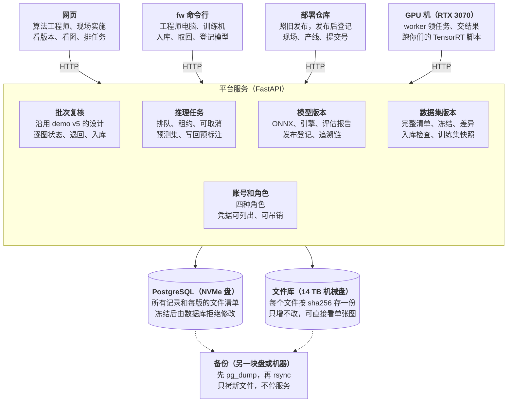

# 数据飞轮底座：开源方案复查与自研架构

> 这是[在线设计文档](https://claude.ai/artifact/A8f2NKVHhLEF295TwomviL) 2026-11-03 的副本，放在仓库里方便审代码时对照；设计改了会在对应的 PR 里同步更新这份。文中 claude.ai 的链接和“项目文件”只有项目成员能打开。

## 结论

没有合适的单个开源项目，推荐自己写：一个服务、一个 PostgreSQL、一个按内容哈希存文件的文件库，三项需求都放在里面。

- 逐项看（下一节）：数据集版本最成熟的 DVC 在 2025 年 11 月被 lakeFS 收购后基本只做维护；lakeFS 开源版只剩单个用户、没有权限；Oxen 还没到 1.0。模型版本的事实标准 MLflow 要连带装整个实验跟踪服务。预标注没有能直接用的，因为标注在 LiteAnno、推理用你们自己的 TensorRT 代码，开源项目只能提供排队。
- 拼两三个开源项目，就有两三套存储、账号和备份；现场、产线、批次、引擎、发布这些哪套都没有，还是要自己写，再加上它们之间的同步代码。
- 我的判断（不是证明）：三项需求里最要紧、也最容易出错的，是文件按内容存、版本不可改、取回来和存进去一模一样。ClearML 恰恰在这里出了错（2.1.x 里复制或改名过文件的版本取不回）。这部分放在第一步，用测试和故障演练钉住；第三步的任务租约和重试是第二个要特别小心的地方。
- 和 ClearML 方案相比：不再需要 MongoDB、Elasticsearch、Redis；备份不用停服务；网页能直接看单张图；权限由我们自己的服务管。代价是网页要自己做，这部分代码以后也归我们维护。
- 已定（2026-11-03）：放弃 ClearML，改为自研。第一步（文件库、数据集版本、命令行）已经做完，[PR #1](https://github.com/LorenzoSun-V/aoi-flywheel/pull/1) 等你审；之后在试点服务器上用同一批 SES TX 数据重跑入库、冷取回和复制改名的检查。

## 开源方案逐项复查

三项需求各看了一遍，每项都没有既合适又轻的现成项目。星数、issue 数和发布日期取自 GitHub 和 PyPI，截至 2026-11-03。

**数据集版本**

| 方案 | 现状 | 合适的地方 | 不合适的地方 |
| --- | --- | --- | --- |
| [DVC](https://github.com/treeverse/dvc) | 1.6 万星；2025-11-18 被 lakeFS 收购，承诺维护和修 bug；最新版 3.67.1 是 2026-03-31 发的，8 月以来主分支 2 次提交 | “按内容哈希存文件 + 每版一个清单”的设计最成熟；纯客户端，存储用本地盘或 SSH 都行 | 每个版本是一次 git 提交，平台服务里要托管 git 仓库；之前的试验里，硬链接缓存被就地改 JSON 改坏了旧版本的 100 个文件（默认的复制模式没问题） |
| [lakeFS](https://github.com/treeverse/lakeFS) | 5.6 千星，355 个未关闭 issue | 服务端像 git 一样管文件：提交、差异、回滚 | 开源版 2024 年起只剩单个用户、没有权限控制，RBAC 和单点登录在企业版；要 PostgreSQL 加 MinIO 或本地块存储，本地块存储不支持垃圾回收；分支合并我们用不上 |
| [Oxen](https://github.com/Oxen-AI/Oxen) | 1.2 千星；0.65.2，几天一个发布 | 专做大数据集版本，Rust 写的 | 还没到 1.0，接口还在变，用的人少，上生产风险大 |
| ClearML 数据集（试点） | 6.9 千星；SDK 488 个、服务端 124 个未关闭 issue | 版本、血缘、冻结都有，网页现成 | SDK 2.1.x 里复制或改名过文件的版本取不回，只能锁 2.0.2；文件打成 zip，网页不能看单张图；要 MongoDB、Elasticsearch、Redis；开源版谁都能删冻结的版本 |

**模型版本**

| 方案 | 合适的地方 | 不合适的地方 |
| --- | --- | --- |
| [MLflow](https://github.com/mlflow/mlflow) 模型注册（2.9 万星，最新 3.17.2） | 事实标准：模型、版本、别名、标签；有按模型的读写权限 | 注册表跑在实验跟踪服务里，要装整个服务，试验里服务端起了 16 个进程、约 2.3 GB 内存；它不知道引擎要按 GPU、TensorRT 版本、精度区分，也不知道现场、产线和部署仓库，这些还得自己建表 |
| ClearML 模型（试点） | 试点里训练、评估、发布一路查得回 | 和上面的数据集是同一套服务，问题相同 |
| [KitOps](https://github.com/kitops-ml/kitops)（1.4 千星） | 把模型打包成 OCI 制品，方便分发 | 要再装一个镜像仓库；只管打包分发，不管发布记录和追溯 |

**预标注（推理）**

| 方案 | 不合适的地方 |
| --- | --- |
| CVAT 自动标注、Label Studio 的 ML 后端 | 绑在它们自己的标注工具里，我们标注在 LiteAnno |
| Triton 推理服务 | 做在线服务，不是批量任务；引擎要和它自带的 TensorRT 版本一致；你们已经有推理代码 |
| 任务队列库：Celery、[Procrastinate](https://github.com/procrastinate-org/procrastinate)（1.4 千星，用 PostgreSQL 排队） | 只管排队。Celery 要另装 Redis 或 RabbitMQ；Procrastinate 要 GPU 机直连数据库，跨网段不方便 |

能复用的是设计，不是软件：DVC 的“内容哈希 + 清单”、MLflow 的“模型 → 版本 → 标签”表结构、CVAT 的任务状态。

未关闭 issue 数本身说明不了什么：MLflow 有 1523 个，项目很健康。ClearML 的问题是缺陷出在我们最依赖的数据集版本上，而我们只用得上它很小一部分。

## 自研架构总览

平台是一个服务加一个 PostgreSQL 和一个文件库；所有机器都只通过 HTTP 找平台服务，只有平台服务碰数据库和文件库。



网页、命令行、部署仓库和 GPU 机调的是同一个服务，跨网段只要开一个端口；三项需求是服务里的三个模块，批次复核沿用已有设计。

- 部署：docker compose 起两个容器（PostgreSQL 和平台服务）。GPU worker 用 systemd 跑在 3070 这台机器上，直接用你们现有的 TensorRT 环境。
- 技术：Python、FastAPI、PostgreSQL，表结构用按序号排列的 SQL 迁移文件管升级；`fw` 是一个 pip 包，Windows 和 Linux 都能用。
- 模块边界：每个模块只管自己的表，调用方向是批次 → 推理 → 模型 → 数据集 → 文件库，只能往下调；CI 里用 import-linter 检查。
- 占用（第一步实测）：跑完 20 万个文件后，平台服务 4 个进程合计约 420 MB，数据库约 130 MB；空闲时服务 220 到 380 MB、数据库 60 到 80 MB。ClearML 试点是约 2 GB，另加 4 GB 的 Elasticsearch 堆。

## 数据集版本

每个版本是一张完整的文件清单（路径 → 内容哈希），文件按哈希只存一份；读任何一个版本都不经过它的父版本。

**存文件**

- 文件库按 sha256 存，路径是 `objects/ab/cd/<哈希>`。上传时先写到同一文件系统里的临时文件，边写边算哈希，对上了才原子地放到最终位置；已有同一哈希的完好文件就丢掉临时文件。文件写进去以后只读，永不修改。落盘顺序见“可靠性”一节。
- 上传前客户端先问“这些文件（哈希和大小）里哪些你没有”，只传缺的。中断后重跑同一条命令，只补传还没传完的文件；这是按文件重试，不是单个大文件内部的断点续传。跨批次、跨现场的去重也靠这一步，平台也能告诉上传的人哪些图以前传过。
- 文件库只通过一个接口访问。以后要多块盘或多台机器，可以换成 S3 兼容存储，上层不用改。

**版本**

- 一个数据集是一条产线的数据池，也可以是测试集或回归集。版本号依次递增，每版记录父版本、来源（哪个批次入库，或从哪个目录导入）、操作人、时间、文件数和大小。
- 清单按行存在 PostgreSQL（版本、路径、哈希、大小）。冻结后，数据库触发器拒绝对清单行的新增、修改和删除，也拒绝修改、解冻和删除版本本身。冻结那一刻，数据库按清单行重算清单哈希、文件数和总大小，和登记的对不上就不冻结；版本必须在建它的同一个事务里冻结，否则提交不了。所以清单内容、哈希和冻结状态总是一起生效，中间插不进别的写入。两个人同时往一个数据集导入时，后提交的被拒绝，要以新的最新版本为父版本重新导入。
- 清单本身也是一个文件，格式固定（仓库里的 [`docs/manifest-format.md`](manifest-format.md)），也按哈希存；它的哈希记在版本里，就是这个版本内容的标识。训练机拿到的就是这个文件，可以自己核对。
- 两个版本的差异用 SQL 对比两张清单：新增、修改、删除，以及改名（同一哈希换了路径，单独列出）。

**入库**

- 两条路：批次复核全部通过后，由算法工程师确认入库（已有设计）；或者用 `fw dataset import` 直接导入一个目录，比如历史数据。
- 入库前的检查沿用试点的 01 号脚本：没标注的图、没有图的标注、同名不同扩展名、只差大小写的文件名、图片和标注以外的文件。你们 intake.py 里按画面分线、标注口径、像素查重这些 SES 专用的检查，做成每个项目可以配的检查，放到批次入库那一步。
- 新旧版本同一路径内容不同算修改，入库预览里列出来，确认后才建版本。两个来源有同一路径时直接报错，不会像 ClearML 那样悄悄用后一个。

**取回**

- `fw get <版本或训练集> --to <目录>`：训练机的本地缓存也按哈希存，只下载缺的文件，下载的文件核对过 SHA-256 才进缓存，再把目录摆出来。
- 默认用 reflink（btrfs、XFS 上不多占盘，改取出的文件也不影响缓存），文件系统不支持就复制（ext4、NTFS）。摆出来的每个文件都重新算 SHA-256 和清单核对，对不上就重新下载；不靠大小和修改时间判断。重新下载的一份原子替换缓存里的旧文件，缓存从不先删：几个 fw 进程共用一个缓存时，一个进程刚读到的索引记录可能已经过时（另一个进程刚装好新的一份），按它删会删掉别人刚装好的文件。硬链接只在明确加 `--hardlink` 时用：不多占盘，但文件是只读的，和缓存共用同一份数据。只限 Linux：Windows 的只读属性由一个文件的所有硬链接共用，删缓存文件时得先去掉它，取出的文件会一起变成可写。
- 连不上平台的机器：`fw export` 把一个版本导成一个带清单的目录，拷过去以后用 `fw verify` 照样能按清单核对，不需要平台。

**训练集快照**

- 快照冻结的是划分的结果，不是规则：每张图的图片哈希和标注哈希、它实际分在 train、val 还是 test、类别编号和名称的对应表。规则（8:2、7:3，新数据进 test 等）只在建快照时用一次；取出时按快照原样还原，永远不重新划分。快照有自己的 ID，取出时按 `<现场>/<产线>/` 分目录，不同产线的同名文件不会冲突。
- 实现：快照是类型为「训练集快照」的数据集的一个版本，它的文件就是取出后的目录（`train|val|test/<现场>/<产线>/<原路径>`、`classes.txt`、`trainset.json`，格式见 [`docs/trainset-format.md`](trainset-format.md)）。所以冻结、取回、导出、核对、对比全部沿用数据集版本，同一张图在文件库里仍只存一份。来源、类别表、规则和统计另记在两张表里，和版本在同一个事务里写、冻结后由触发器拒绝修改。
- 同名快照再建一版时，默认接着上一版：原来的样本不换划分，新样本进 test（可选进 train/val，或把旧 test 并入 train/val）。train/val 按 `sha256(种子 + 样本标识)` 排序后按比例切，同样的输入总得到同样的划分；也可以给一份自己的划分清单。建之前服务器读每个标注，类别表以外的类别直接拒绝。
- 训练脚本只认这个 ID，模型登记时带上它，追溯链就从模型接到了具体文件。模型版本引用快照里的那张类别表，推理和评估都按它解释类别编号。这就是之前定的五个文件约定里的“数据导出清单”。

## 模型版本

模型版本登记 ONNX、训练集快照和指标，引擎、评估和发布都挂在版本下面；从任何一次发布都能一路查回训练用的文件。

| 记录 | 内容 | 谁来写 |
| --- | --- | --- |
| 模型 | 名称、现场、产线、任务类型（检测、分割等） | 算法工程师 |
| 模型版本 | ONNX（按哈希存）、训练集快照 ID、训练代码提交号、验证指标、备注 | 训练脚本或 `fw model register` |
| 引擎 | ONNX 哈希、部署仓库提交号、构建配置的哈希、GPU 型号、TensorRT 版本、精度（FP32 或 FP16）、引擎文件、构建日志 | GPU 机上的构建任务，调用你们部署仓库里的构建入口 |
| 评估报告 | 用的 ONNX 或引擎、测试集版本、指标、报告文件、aoi-deteval 版本 | 评估任务（第二阶段） |
| 发布 | 发布 ID、现场、产线、部署仓库地址和提交号、用的模型版本或引擎、部署成功时间、登记时间、操作人 | 部署仓库发布后调接口 |

- 登记时核对文件已经在服务器上，否则拒绝，不会再出现只登记了训练机本地路径的情况。
- 模型版本登记后不能改。引擎按“ONNX 哈希 + 部署仓库提交号 + 构建配置哈希 + GPU 型号”识别，同一组合只建一次。哪个引擎能在哪台机器上用，按你们部署仓库给的兼容规则判断，平台不自己定。
- 不做 MLflow 那种“阶段”流转。“某条产线现在用的是哪个模型”由实际部署成功时间最晚的那条发布记录回答。每条发布有唯一的发布 ID，同时记部署成功时间和登记时间，所以事后补登的旧发布不会顶掉后来真正部署的那次。标签只用来标候选、弃用。
- 现场拿 ONNX 自己转引擎的，发布记录只指向模型版本，并写上现场的 TensorRT 版本。
- 追溯链：`fw model chain <发布或模型版本>` 和网页上同一页显示：发布 → 引擎 → 模型版本 → 训练集快照 → 数据池版本 → 入库批次。归档过的记录在追溯链里照样显示。

训练脚本接入只要几行（接口示意，名字以后再定）：

```python
import fw
ts = fw.get_trainset('SES-TX-det@2', '/data/train/SES-TX-det@2')   # 取到本地，返回 id、目录、类别表
# ……现有训练代码读 ts['path']……
fw.register_model('SES-TX-detr', onnx='best.onnx', trainset=ts['id'], metrics='val.json')   # 第二步后半，名字待定
```

## 预标注和推理任务

推理是一个排队的任务：GPU 机上的 worker 领任务，用你们现有的 TensorRT 脚本推理，交回一个不可变的“预测集”；预标注就是把预测集按阈值写成未确认的标注。

1. 提交：网页或 `fw job prelabel --batch <批次> --model <模型版本>`。复用已有的预测集要四样都相同：输入图片清单的哈希、引擎哈希、推理代码版本（部署仓库提交号）、实际生效的推理配置的哈希（阈值、NMS 等）。四样都相同就直接复用，不再占 GPU；任何一样不同都重新跑。
2. 排队：任务存在 PostgreSQL 的任务表里，按提交顺序执行。一张 3070 同时只跑一个任务，多人同时提交就排队，网页上显示前面还有几个。
3. 领取：GPU 机上常驻一个 `fw worker`，每隔几秒问平台要任务；平台用 `FOR UPDATE SKIP LOCKED` 发给它一个，附带租约和这次领取独有的令牌（每次领取、每次重试都是新令牌）。续租、上传结果、报告完成都要带这个令牌；租约过期或任务被取消后，旧令牌的请求一律拒绝，所以掉线后又连上的 worker 改不了已经重新派出去的任务。机器死机或断网时租约过期，任务自动回到队列，重试次数有上限。
4. 执行：worker 只管调度，不带推理和构建代码。它按哈希把图片和引擎取到本地缓存，摆成输入目录，然后调用你们 TRT 部署仓库里现有的入口，用 `{input}`、`{output}`、`{engine}` 这样的占位符传路径，和试点的 07 号脚本一样。具体怎么调，第三步拿到你们的部署代码后再接。日志实时传回网页，任务可以取消。
5. 校验和交回：每张图输出一个带置信度的 X-AnyLabeling JSON。worker 检查每个 JSON 能读、对得上输入图、类别在模型版本引用的类别表里，然后上传，平台存成预测集。
6. 写回：按阈值把预测写成这些图的新标注版本，`checked=false`，来源记为哪个模型版本；现场实施再用 LiteAnno 改。

- 预测集也是评估的输入（第二阶段）：打分不需要 GPU，换指标只要重算。换阈值只能在已保存的预测范围内：预测集按推理时用的最低阈值保存，往高调直接重算；要低于保存时的阈值，就得重新推理。
- 引擎构建（ONNX 转 FP32、FP16 引擎）也是排队任务，由同一个 worker 调用你们部署仓库里的构建入口。平台记下 ONNX 哈希、部署仓库提交号、构建配置的哈希和构建日志；引擎能在哪些 GPU 和 TensorRT 版本上用，按部署仓库给的规则判断。
- worker 只访问平台服务的那一个端口，不直连数据库；以后加 GPU 机就是多起一个 worker。
- 试点里 ClearML agent 每个任务除推理外有约 20 秒固定开销（我这边测的）；自研版的这项开销到时候实测。

## 可靠性、备份和权限

可靠性靠三条：文件先校验再生效，版本冻结由数据库强制，备份不停服务并定期演练恢复。

- 写入：同一文件系统里的临时文件 → 核对哈希 → 原子改名 → 建版本前对整个文件库做一次 syncfs（文件内容和目录项一起落盘）→ 提交数据库。任何一步失败都不会留下半个文件，也不会留下缺文件的冻结版本；数据库记录只在文件落盘后才提交，所以记录里出现的哈希一定有文件。不逐个文件 fsync：按机械盘每次 fsync 约 5 到 10 毫秒估算，二十万个小文件逐个 fsync 要 15 到 30 分钟，一次 syncfs 就覆盖全部。syncfs 报错时文件库停止接受写入，用三种方式记住，盘满时也拦得住：服务进程里记着；删掉文件库根目录的 WRITE-OK（删除不占空间），所有服务进程、包括重启后的都看得到；写下 WRITE-ERROR 说明原因（写得进去的话）。只有 `fw-server verify --rehash` 能解除：文件库里的每个文件都从盘上读出来核对，被版本引用的必须全部通过（或从备份修好）；还没有版本引用的（导入中断时留下的）坏了就移到 quarantine/，重试导入时平台报告缺它，客户端会重新上传，不会复用坏文件；任何目录或文件读不出来，核对都不通过；全部落盘之后，才重新写一个 WRITE-OK。断电或死机不报错，却会丢掉没落盘的写入（没落盘的文件可能大小不变、内容全零），所以每次写入前先落盘一个 UNSYNCED 标记，写明本次开机的编号（加一段随机内容），全部落盘后删掉。看得见不等于已落盘：建标记的进程只持共享锁，可能还没对目录 fsync、fsync 失败或者中途退出，所以每个进程只信自己确认过落盘的那一份（每份标记确认一次，对根目录 fsync，谁改的名都一起落盘）；确认时 fsync 出错，按写盘出错停止写入，因为出过错之后再成功的 fsync 也证明不了什么。重启后发现上次开机留下的 UNSYNCED，同样停止写入，直到 verify --rehash 通过；删不掉它、或者解除后仍有阻断原因时，verify 报错退出，不报告已解除。只在断电时真有没落盘的写入才需要这次核对。盘坏到连删除都做不到时只剩进程里的记录，修好盘后要先跑 verify --rehash。补传旧版本缺的文件、从备份修复之后，也先落盘再报告成功。
- 核对：`fw-server verify` 检查每个版本的清单行能重建登记的清单哈希，每个被引用的哈希都有文件、大小对。每周在空闲时加 `--rehash` 把文件库重算一遍哈希，读之前丢掉页缓存，确保读到的是盘上的内容（写回出错后，页缓存里可能还留着没写到盘上的数据）；机械盘有坏块时用 `--repair-from` 从备份里取回同一哈希的文件。
- 备份：先 `pg_dump`（不停服务，得到一致的快照），再把文件库 `rsync` 到另一块盘或另一台机器。文件只增不改，每天只拷新文件。因为记录总在文件落盘后才提交，备份里的每条记录都有对应的文件。
- 恢复：换上备份里的数据库（原来的改名保留），在不开端口的一次性容器里按这份数据库逐个从盘上重算哈希，缺的和坏了的从备份补回并落盘；全部通过才对外服务，任何一步失败都换回原来的数据库。和试点一样，上线前在另一台机器上演练并记秒数。
- 清理：只有没有任何版本、模型、预测集、批次引用，而且超过 30 天的文件才算可清理；归档的东西仍算引用。先出清单，人确认后才删。备份期间暂停清理，因为备份是先导出数据库再拷文件，中间被删的文件会让备份缺文件。试点期间不清理，第一步也没有清理功能。

| 角色 | 能做 | 不能做 |
| --- | --- | --- |
| 现场实施 | 上传、下载自己的批次，提交预标注和复核 | 入库，动版本和模型 |
| 算法工程师 | 复核、退回、入库、导入、训练集快照、登记模型、提交任务 | 归档、清理 |
| 部署 | 登记发布 | 其他写操作 |
| 管理员 | 账号、归档、清理 | 删冻结版本和发布过的模型 |

每台机器一个凭据，网页上能列出、能吊销；停用账号会立即吊销它的全部凭据。冻结的数据集版本、训练集快照、模型版本和发布记录，任何角色都删不掉。归档只是从默认列表里隐藏：只有管理员能做，记录和文件都保留，追溯链里照样显示，随时能取消。

## ClearML 试点经验怎么用

试点里碰到的每个问题都变成一条设计规则，第八节的验证项原样作为自研版的验收清单。

| 试点里碰到的 | 自研方案里的规则 |
| --- | --- |
| SDK 2.1.x 里复制或改名过文件的版本取不回 | 每版存完整清单，读版本不经过父版本；复制、改名、删除、修改的组合写成自动测试，每次改代码都跑冷取回比对 |
| 文件地址写死在记录里，用 IP 或 localhost 登记以后就改不了 | 记录里只存哈希，服务器地址只在客户端配置里 |
| 没设 output\_uri 时模型只登记了训练机本地路径 | 登记时核对文件已在服务器上，否则拒绝 |
| 开源版没有权限，谁都能删冻结的版本 | 角色由服务检查；冻结版本和发布过的模型删不掉 |
| 改密码不会让已发的凭据失效 | 凭据可列出、可吊销；停用账号即吊销 |
| 两个父版本有同一路径时悄悄用后一个 | 同一路径冲突直接报错 |
| 备份要停服务 72 秒 | pg\_dump 加 rsync，不停服务 |
| 文件打成 zip，网页不能看单张图 | 每个文件单独存，网页直接取 |
| 训练机要访问 8008 和 8081 两个端口（网页还要 8080） | 只开平台服务一个端口 |

试点服务器上的 ClearML 先留着，等自研第一步在同一台机器上验收过再停。它里面没有唯一的一份数据（源目录还在 /data 下），停掉后我给你清理命令，你确认了再删。

## 分期和风险

分四步，一步一个 PR，你审过再做下一步；每步都在试点服务器上用真实数据验收。前三步做完，就能替代 ClearML 在试点里的全部用途。

1. 文件库、数据集版本、`fw` 命令行（入库、取回、差异、导出），加上部署脚本和备份恢复脚本。
   - 验收：SES TX v1 原样入库；用 TX\_v2\_test 建 v2，并故意加进复制和改名的文件；在笔记本或训练机上冷取回，逐个文件比对一致；不停服务备份，在另一台机器上恢复后再取回一致。三项故障测试：改取出目录里的文件不影响缓存，再取一次仍和版本一致；冻结后往清单里加行被数据库拒绝；上传中途或提交中途失败，都不会留下缺文件的冻结版本。另外用合成的十万级文件实测入库、取回、差异的时间。
2. 模型版本、引擎、发布登记、追溯链。
   - 验收：重跑试点第 3、6 步，追溯链完整。
3. 推理任务、GPU worker、预测集、预标注写回。批次复核接上之前，预标注结果可以下载成 LiteAnno 能直接打开的目录。
   - 验收：同时排 3 个预标注任务，依次跑完，结果用 LiteAnno 打开；同一任务再提交直接复用结果；跑到一半停掉 worker，任务自动回到队列。
4. 网页：数据集版本、差异、看图，模型和追溯链，任务队列；之后接上批次复核（demo v5 的设计）。

工作量是估计，不是承诺。原来估的前三步 5 千到 7 千行偏少：第一步就写了约 2600 行 Python 和 SQL（客户端约 1300 行、服务端约 1200 行），另有测试约 1200 行、部署和工具脚本约 450 行。第二、三步的大小和时间按第一步的实际情况重估，每步做完报实际数字，网页另算。

| 风险 | 对策 |
| --- | --- |
| 自己写的存储层有缺陷 | 核心存储代码（文件库、清单、冻结触发器、取回和缓存）约 1000 行；复制、改名、删除、修改的随机组合测试加冷取回比对；冻结和故障测试跑在真实的 PostgreSQL 上；每周全量核对哈希；备份里有同一哈希的副本 |
| 规模没验证过 | 第一步就用合成的十万级、百万级文件实测，只报实测数字 |
| 网页工作量大 | 命令行先行；网页沿用 demo 的设计，只做查看和审批 |
| 只有一台服务器 | 每天备份到另一块盘或另一台机器，恢复写成脚本并演练 |
| 训练机跨网段连不上 | 只需开一个端口；实在不通就用 `fw export` 拷盘 |
| 这些代码以后归我们维护 | 模块边界在 CI 里检查；每个模块有测试和说明文档 |

第一步实测（2026-11-03，我这台 4 核云机，docker compose 部署，客户端和服务在同一台机器，走 HTTP）：复制改名场景、5 组 × 60 个随机版本、部署后在线备份再异地恢复，取回都和源目录逐个文件一致。20 万个文件（约 0.9 GB）第一版入库 53 秒，第二版 33 秒，差异 0.2 秒，冷取回 136 秒，热取回 39 秒。这是小文件改成批量传输（一次请求几千个文件）以后的数字，之前每个文件一次 HTTP 请求时分别是 470、89、0.2、648、123 秒；不走 HTTP 的原型是入库 55 秒、冷取回 58 秒。百万级还没测。

## 来源

- [DVC 加入 lakeFS 的问答](https://dvc.org/blog/dvc-joins-lakefs-your-questions-answered)（DVC 官方博客，2025-11-18）
- [lakeFS 收购 DVC 的新闻稿](https://lakefs.io/blog/lakefs-acquires-dvc/)
- [lakeFS 把权限控制移出开源核心的说明](https://lakefs.io/blog/why-moving-acls-out-of-core-lakefs/)（2024-07-30）
- [lakeFS 本地部署文档](https://docs.lakefs.io/admin/install/onprem/)
- 星数、未关闭 issue 和提交数来自 GitHub 搜索接口；发布日期来自 PyPI（[dvc](https://pypi.org/project/dvc/)、[mlflow](https://pypi.org/project/mlflow/)、[oxenai](https://pypi.org/project/oxenai/)、[clearml](https://pypi.org/project/clearml/)、[procrastinate](https://pypi.org/project/procrastinate/)）；都是 2026-11-03 查的。
- 试点和之前的试验：[ClearML 方案设计文档](https://claude.ai/artifact/Fvi5e9hb3byqcjDzpwfmVv)，项目文件里的 flywheel-pilot 验证包和 flywheel-spike 试验记录。
